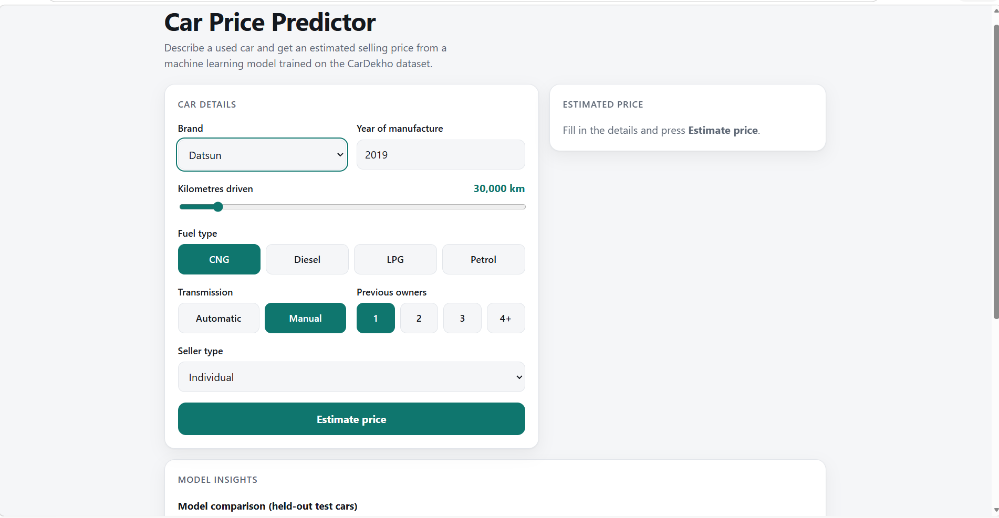
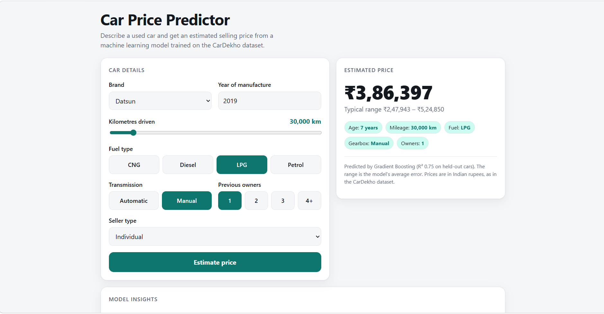
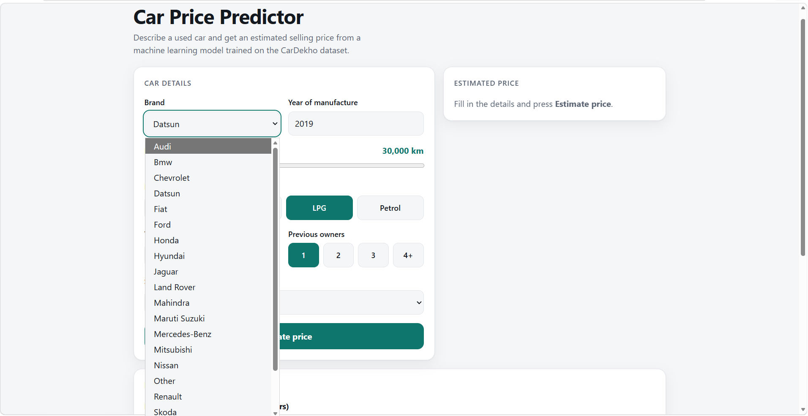
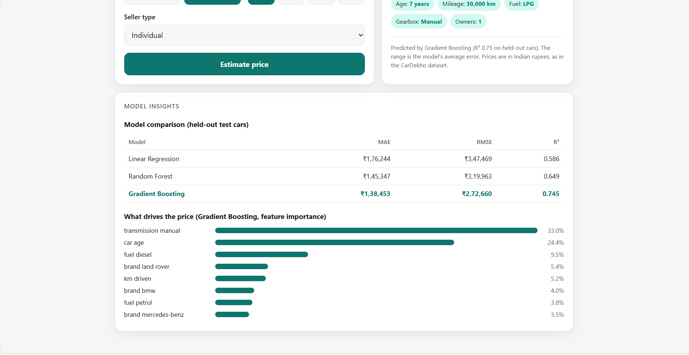

# Car Price Predictor

**A simple web tool that estimates what a used car should sell for, based on a handful of basic details.**

Pricing a used car is usually guesswork. Sellers don't know what to ask, and buyers don't know if an asking price is fair. This project explores whether a machine learning model can give a sensible starting point using only information anyone can provide: the brand, the year, the kilometres driven, the fuel type, the gearbox, the number of previous owners and the type of seller.

The result is a working website. You enter a car's details, press one button, and get an estimated price along with a realistic range.

---

## See it in action

### 1. Describe the car

The page asks for seven simple details. There is nothing technical to fill in, and every field uses a dropdown, a slider or a button, so it is hard to enter something invalid.



### 2. Get an estimate

One click returns an estimated price, a typical range, and a short summary of the details the estimate was based on. In this example, a 2019 Datsun with 30,000 km on the clock, running on LPG, with a manual gearbox and one previous owner, comes out at about **₹3,86,397**, with a typical range of **₹2,47,943 to ₹5,24,850**.



The range matters. A single number looks precise, but it isn't, so the page shows how far off the model is on average. That way the person using it knows to treat the figure as a guide, not a quote.

### 3. Choose from real brands

The brand list comes straight from the data the model learned from. Brands with very few cars in the dataset are grouped under "Other", because the model can't learn much from a handful of examples.



### 4. See how the model thinks

Below the estimator, the page is open about how the model was built and how well it works. It compares the three models that were tested and shows which details move the price the most. The goal is for anyone using the tool to see what is behind the number.



---

## What we found

The best model, **Gradient Boosting**, explains about **75% of the variation in used car prices** (R² of 0.745). On average its estimate is about **₹1.4 lakh** away from the real selling price.

That is useful, but it is not perfect, and it's worth being plain about why. The dataset doesn't include engine size, trim level, condition or service history. These all affect what a car is worth, and the model can't see any of them.

What drives the price, in order of importance:

1. **Transmission.** Manual cars sell for noticeably less than automatics. This is the strongest signal (33%).
2. **Car age.** Older cars are cheaper (24%).
3. **Diesel fuel.** Diesel cars tend to sell for more than petrol ones (9.5%).
4. **Luxury brands.** Land Rover, BMW and Mercedes-Benz stand out.
5. **Kilometres driven.** This mattered less than we expected.

The number of previous owners had almost no effect on price in this data.

---

## How it was built

The whole project is written in Python, using pandas and scikit-learn for the data work and a small Flask app for the website. The analysis lives in one Jupyter Notebook, so every step can be read, re-run and checked.

### The data

We used the public [Vehicle dataset from CarDekho](https://www.kaggle.com/datasets/nehalbirla/vehicle-dataset-from-cardekho) on Kaggle. It contains 4,340 used cars, with the name, year, selling price (in Indian rupees), kilometres driven, fuel type, seller type, transmission and number of owners. A copy is saved in `data/cardekho.csv`.

### The steps

1. **Loading the data.** We read the file and checked what we had: 8 columns and 4,340 rows.
2. **Cleaning it.** There were no missing values, but we wrote the code to handle them anyway in case the data changes. The real problem was duplicates: 763 rows (about 18%) were repeats, and removing them left 3,577 cars. We also standardised the text, so "Petrol" and "petrol" count as the same thing. Finally, we removed the single electric car, because one example isn't enough for a model to learn from. That left **3,576 cars**.
3. **Creating better inputs.** A raw year isn't very informative, so we turned it into **car age**. We also pulled the **brand** out of each car's name and fixed a few oddities, such as "Maruti" becoming Maruti Suzuki and "Land" becoming Land Rover. Brands with fewer than 5 cars were grouped as "Other".
4. **Exploring the data.** We charted how prices are spread, how they differ by fuel type, and how they change with age. Prices are heavily skewed. Half of the cars sell for between 2 and 6 lakh, but the most expensive sells for 89 lakh. Diesel cars sell for more than petrol cars, and older cars are cheaper, although a 10-year-old Maruti and a 10-year-old Mercedes are obviously very different cars.
5. **Turning words into numbers.** Models only work with numbers. Owner count has a natural order (first, second, third), so we encoded it in that order. Brand, fuel, seller type and gearbox have no order, so each option became its own yes/no column. This gave **29 inputs** in total.
6. **Checking relationships.** A correlation heatmap showed that manual transmission and car age are most strongly linked to lower prices, while luxury brands such as BMW and Mercedes are most strongly linked to higher prices.
7. **Keeping some cars hidden.** We set aside 20% of the cars (716) purely for testing and trained on the other 2,860. This shows how the models perform on cars they have never seen, which is the honest test.
8. **Training three models.** We tried Linear Regression, Random Forest and Gradient Boosting, from simplest to most complex.
9. **Comparing them.** Each model was scored on the hidden cars using three measures:
   - **MAE** is the average mistake in rupees.
   - **RMSE** is similar, but big mistakes count for more.
   - **R²** is how much of the price variation the model explains. Higher is better, and 1.0 is perfect.

   | Model | MAE | RMSE | R² |
   |---|---|---|---|
   | Linear Regression | ₹176,244 | ₹347,469 | 0.586 |
   | Random Forest | ₹145,347 | ₹319,963 | 0.649 |
   | **Gradient Boosting** | **₹138,453** | **₹272,660** | **0.745** |

   Gradient Boosting won on all three measures.
10. **Understanding the winner.** We looked at which inputs the winning model relies on most (see the findings above).
11. **Saving it.** The final model is saved into the `model/` folder, so the website can use it instantly without retraining.

---

## What's in the folder

| File or folder | What it is |
|---|---|
| `car_price_prediction.ipynb` | The notebook with all the data work. Start here. |
| `data/cardekho.csv` | The dataset. |
| `model/` | The trained model saved by the notebook. |
| `app.py` | The Flask app that loads the model and answers requests. |
| `public/index.html` | The web page. |
| `screenshots/` | The images used in this README. |
| `render.yaml`, `.vercelignore` | Settings used only for deploying the site. |

---

## Try it yourself

### Run the website on your computer

```
pip install -r requirements.txt
python app.py
```

Then open http://localhost:3000, fill in a car's details and press **Estimate price**. If `python` doesn't work on Windows, try `py app.py`.

### Run the notebook

```
pip install -r requirements-train.txt
jupyter notebook car_price_prediction.ipynb
```

Run all the cells from the top. It takes under a minute, and the charts appear as it goes. If you use VS Code, choose the Python you installed the packages into when it asks for a kernel. Running the notebook saves a fresh copy of the model into `model/`.

---

## Putting it online

First, put the project on GitHub:

```
git init
git add .
git commit -m "car price predictor"
git branch -M main
git remote add origin https://github.com/YOUR-USERNAME/car-price-predictor.git
git push -u origin main
```

**On Vercel:** go to vercel.com, click **Add New**, then **Project**, import the repository and press **Deploy**. No settings need changing. Vercel finds `app.py` by itself and serves the page from the `public` folder.

**On Render:** go to render.com, click **New +**, then **Blueprint**, pick the repository and click **Apply**. It reads `render.yaml` for the settings. To set it up by hand instead, create a Python web service with the build command `pip install -r requirements.txt`, the start command `gunicorn app:app`, and an environment variable `PYTHON_VERSION` set to `3.12.8`. On the free plan the site goes to sleep when nobody is using it, so the first visit can take about a minute.

Two things to remember:

- The `model/` folder **must** be pushed to GitHub, because the site can't run without it.
- The `scikit-learn` version must be the same in both requirements files, because a saved model only loads reliably on the version that created it.

---

## Limitations

- **The estimate is a guide, not a valuation.** It can't see condition, engine size, trim or service history.
- **Prices are in Indian rupees** and reflect the CarDekho market, so they shouldn't be applied directly to other countries.
- **The data has a fixed point in time.** Used car prices change, so the model would need fresh data to stay accurate.
- **Rare cars are less reliable.** Brands with few examples are grouped together, and very expensive cars are scarce in the data.

## What comes next

- Apply a log transform to the price, since it is so skewed.
- Tune the models properly using cross-validation.
- Find or collect a dataset with richer details, such as engine size and trim level.
- Refresh the model regularly with newer listings.
