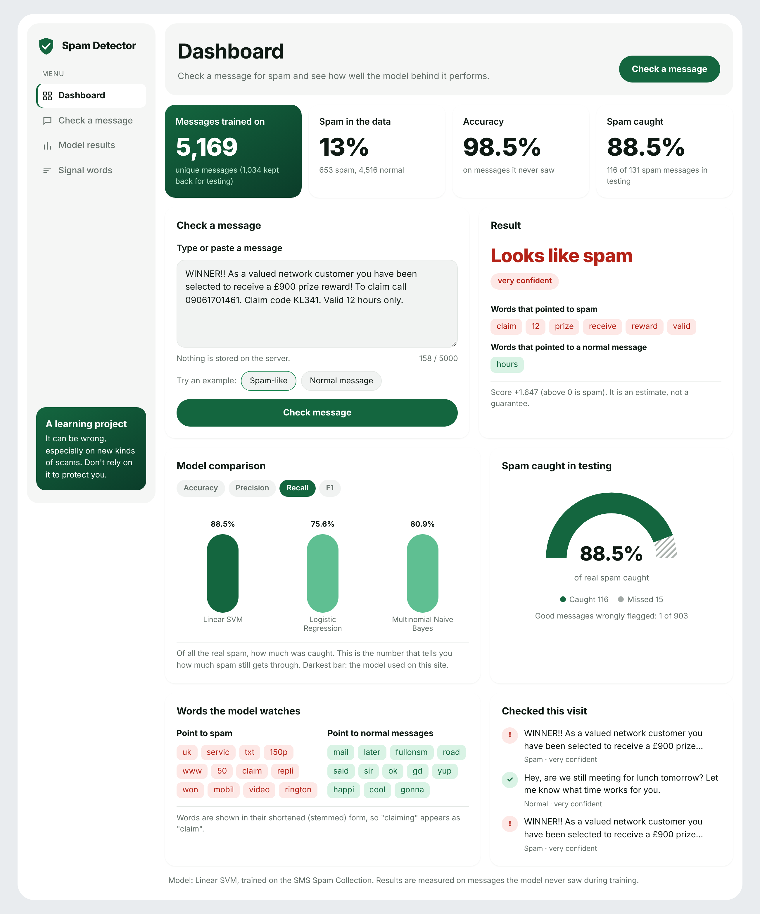
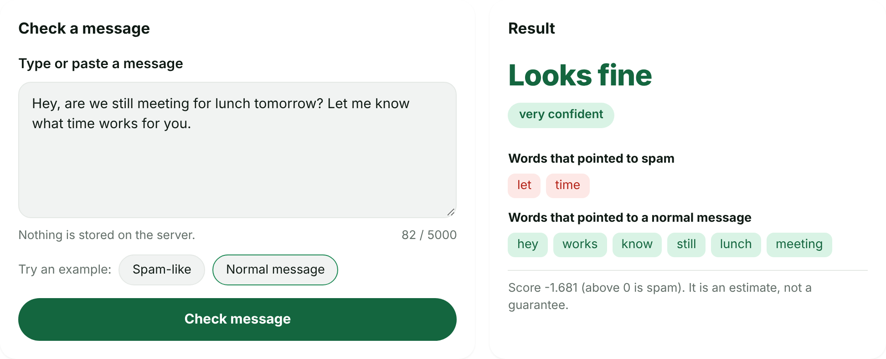
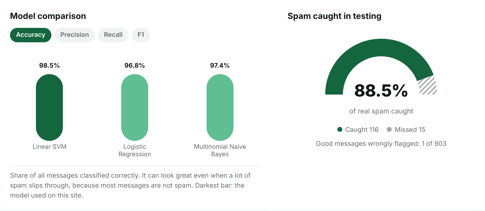
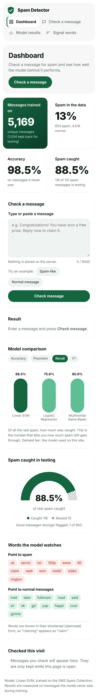

# Spam Detector

**A machine learning model that reads a message and tells you whether it is spam, plus a small website where anyone can try it.**

Spam is more than an annoyance. It is the main way scams and phishing reach people, and every message that slips through is a chance for someone to lose money or a password. This project shows how a simple, well-understood piece of machine learning can learn to spot spam from the words in a message, how well it does, and where it still falls short.

It has two parts:

- **A notebook** (`email_spam_detection.ipynb`) that walks through the whole job: loading the data, cleaning the text, training models, and judging them fairly.
- **A website** where you paste a message and get a verdict, along with the words that gave it away.

---

## See it in action

The website is a single dashboard: key numbers at the top, a box to check a message, and the model's results underneath.

### The dashboard



### Check a message, see why

The result isn't just a label. The page shows which words pushed the decision towards spam (here `claim`, `prize`, `reward`) and which pulled the other way, so a person can see the reasoning. Messages checked during a visit are listed on the page and are not stored anywhere.



### Honest about how well it works

Switch between accuracy, precision, recall and F1 to compare the three models, all measured on messages they never saw during training. The gauge shows how much of the real spam was caught and how much slipped through. The bars start at zero, so the differences aren't exaggerated.



### On a phone

The layout adapts to small screens.



---

## What we found

We trained three models on 5,169 unique text messages and tested them on 1,034 they had never seen. The **Linear SVM** came out clearly ahead:

| Model | Accuracy | Precision | Recall | F1-score |
|---|---|---|---|---|
| **Linear SVM** (used on the website) | **98.5%** | **99.2%** | **88.5%** | **0.935** |
| Multinomial Naive Bayes | 97.4% | 98.2% | 80.9% | 0.887 |
| Logistic Regression | 96.8% | 99.0% | 75.6% | 0.857 |

In plain terms, of the 131 spam messages in the test set, the SVM caught **116** and missed **15**, and it wrongly flagged only **1** normal message. Naive Bayes missed 25 spam messages and Logistic Regression missed 32.

**Why we look beyond accuracy.** Only about 13% of the messages are spam, so a lazy model that called everything "normal" would score about 87% accuracy while catching nothing. That is why this project looks at precision, recall and F1:

- **Precision** is how often a "spam" call is right.
- **Recall** is how much of the real spam gets caught.
- **F1** balances the two in one number.

Logistic Regression shows the problem well. It has 96.8% accuracy, which sounds great, but its recall is only about 76%, so roughly 1 in 4 spam messages gets through.

**Why recall matters so much.** Each missed spam message lands in someone's inbox, and that is where scams do their damage. But recall isn't everything: a filter that blocks too aggressively buries real messages such as job offers and bank notices. A good filter needs both high recall and high precision. The notebook discusses this in more detail.

---

## How it works

The notebook follows these steps, each in its own section:

1. **Load the data and check the class distribution.** 5,572 messages, of which 4,825 (86.6%) are normal ("ham") and 747 (13.4%) are spam. The data is imbalanced, which is why accuracy alone can mislead.
2. **Clean the text.** Lowercase everything, remove punctuation, remove common filler words ("the", "and"), and shorten words to their root ("winning" becomes "win"). We keep numbers on purpose, because prices and phone numbers are useful spam clues. We also removed 403 duplicate messages, so the same message can't appear in both the training and test sets and make the results look better than they are.
3. **Turn words into numbers with TF-IDF.** TF-IDF scores each word by how often it appears in a message (term frequency) and how rare it is across all messages (inverse document frequency). A word that is frequent in one message but rare overall, like "prize", scores high. Everyday words score low.
4. **Split into training and test sets.** 80% for learning (4,135 messages) and 20% held back for testing (1,034). The split keeps the same spam share in both, and the TF-IDF step learns from the training messages only, so no information leaks in from the test set.
5. **Train the models.** Multinomial Naive Bayes (the standard for text), Logistic Regression (the alternative), and a Linear SVM as a bonus comparison.
6. **Evaluate.** Accuracy, precision, recall, F1 and a confusion matrix for each model.
7. **Discuss why recall matters.** Written up in the notebook.
8. **Bonus: word clouds.** Spam is full of words like `call`, `free`, `txt`, `claim` and `prize`. Normal messages look like everyday chat.
9. **Save the best model.** Instead of saving a heavy Python object, the notebook saves just the weights the model learned for each word into a small JSON file (`model/model.json`, about 77 KB). The website scores messages with a few lines of plain Python, so it needs no machine learning library, which keeps it small and quick to start.

---

## What's in the folder

| File or folder | What it is |
|---|---|
| `email_spam_detection.ipynb` | The full analysis, with comments and explanations. Start here. |
| `data/spam.csv` | The SMS Spam Collection dataset. |
| `preprocess.py` | The text-cleaning code, shared by the notebook and the website so both treat messages identically. |
| `model/model.json` | The trained model, saved by the notebook. |
| `app.py` | The Flask app that checks messages. |
| `public/index.html` | The web page. |
| `requirements.txt` | What the website needs (Flask and NLTK). |
| `requirements-train.txt` | What the notebook needs. |
| `screenshots/` | The images used in this README. |
| `.vercelignore` | Keeps the data and notebook out of the deployment. |

---

## Try it yourself

### Run the website on your computer

```
pip install -r requirements.txt
python app.py
```

Then open http://localhost:3000. On Windows, if `python` doesn't work, try `py app.py`.

### Run the notebook

```
pip install -r requirements-train.txt
jupyter notebook email_spam_detection.ipynb
```

Run all the cells from the top. It takes under a minute. It reads `data/spam.csv` and writes a fresh `model/model.json`, so run it from the project folder.

---

## Putting it online with Vercel

First, put the project on GitHub:

```
git init
git add .
git commit -m "spam detector"
git branch -M main
git remote add origin https://github.com/YOUR-USERNAME/spam-detector.git
git push -u origin main
```

Then:

1. Go to vercel.com and click **Add New**, then **Project**.
2. Import your GitHub repository.
3. Leave the settings as they are and press **Deploy**.

Vercel finds `app.py` and runs it, and it serves the page from the `public` folder. You don't need to change any settings.

Things to remember:

- **`model/model.json` must be pushed to GitHub.** The site can't work without it.
- The data and notebook are left out of the deployment on purpose (see `.vercelignore`), which keeps it small. They stay in your repository.
- The first visit after a quiet period can be slightly slower while Vercel starts the app.

---

## Limitations

- **The data is old and short.** These are SMS messages from around 2005. Modern spam uses new wording, other languages, links and images that this model has never seen. The same method works on emails, but it would need to be trained on email data.
- **It misses some spam.** The best model catches about 88.5% of spam, so around 1 in 9 still gets through.
- **It reads words, not meaning.** It can't tell that a polite-sounding message is a scam if the usual spam words are missing, and it can be fooled by unusual spelling.
- **It is a learning project.** Don't rely on it to protect you from scams.

## What comes next

- Train on real email data, and on a larger and more recent dataset.
- Try adding word pairs (such as "click here") as features.
- Tune the models with cross-validation, and adjust the decision threshold to trade recall against precision.
- Retrain regularly, because spammers change their wording all the time.

---

*Data: [SMS Spam Collection](https://archive.ics.uci.edu/dataset/228/sms+spam+collection) (UCI Machine Learning Repository).*
